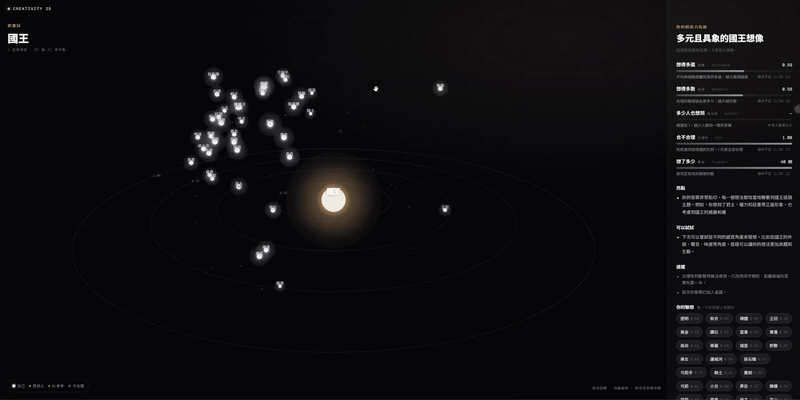

# 創造力視覺化｜聯想星雲（Creativity 3D）

> 選一個詞，三分鐘寫下所有聯想。每個想法會變成 3D 星空中的一顆星：離中心越遠，想得越遠。

這是我碩士論文〈人類、AI 協作與生成式 AI 在不同抽象尺度下的創造力表現〉的延伸產品。

論文的發現之一是：**語意距離（機器算）和專家評分（人判）的相關只有 rs = .046**，兩把尺量的幾乎是不同的東西。用單一分數量不出創造力，所以這個工具改用「多個維度 + 視覺化」，讓使用者看見自己的聯想風格，並和其他人比較。



▶ [觀看完整 Demo 影片（MP4，22 秒）](docs/demo.mp4)

## 功能

- **3D 聯想星圖**：刺激詞在中心，星星離中心的半徑 = 真實語意距離（不會因投影變形）
- **聯想橋**：點一顆星，畫出 AI 推論的連結路徑，例如「蘋果 → 掉落 → 萬有引力 → 牛頓」
- **五維創造力指紋**：距離（想得多遠）、廣度（想得多散）、稀有度（多少人也想到）、合理性、數量
- **與其他人比較**：使用者同意匿名分享後加入公共星雲；同一詞累積 20 人後顯示百分位
- **亂答防護**：遠而合理才算分，亂打的字不會因為語意距離遠而拿高分
- **自訂刺激詞**：新增自己的詞，勾選後才公開到社群詞庫
- **玩家暱稱 + PIN**：換裝置也能找回紀錄，重看當時的星圖

## 設計理由

| 決策 | 理由 |
|---|---|
| **LLM 不打分** | 分數全部由程式計算，結果穩定、可重現。LLM 只判斷「合理性」和撰寫解讀；解讀引用的每個數字都會被逐一比對，不能編造 |
| **遠而合理才算分** | 亂打的字語意距離反而很遠。三層檢查：規則層（亂碼、注音、injection）→ 向量層（極端值）→ LLM 層（能否在 3 步內找到聯想橋） |
| **本機 Ollama** | qwen2.5 7B + bge-m3，資料不出電腦、零 API 成本。模型呼叫包成可抽換的介面，部署時改 `.env` 就能換雲端 API |
| **Structured Output** | 所有 LLM 輸出都以 JSON Schema 約束，再用 Pydantic 驗證；失敗自動重試最多 3 次，再失敗退回保守結果 |
| **不給單一總分** | 避免被誤讀成「創造力智商」；介面標示「這是聯想風格指標，不是能力測驗」 |
| **分享前人工確認** | 寫入公共星雲前必須由使用者勾選同意；暱稱不會出現在公共星雲 |

## 架構

```
瀏覽器（Three.js 星圖、作答頁、指紋面板）
   │  /api/*
   ▼
FastAPI
   ├─ pipeline.py      串接：遮蔽個資 → 規則層 → embedding → LLM 判斷 → 計分 → 投影 → 解讀
   ├─ guardrails.py    規則層：亂碼、注音、injection、不雅字詞、個資遮蔽
   ├─ llm_tasks.py     合理性判斷、聯想橋、解讀、AI 種子點（Structured Output）
   ├─ scoring.py       五維指紋、百分位
   ├─ projection.py    PCA 投影（方向）＋ 真實語意距離（半徑）
   ├─ store.py         SQLite：刺激詞、AI 種子、作答、玩家
   └─ providers/       LLMProvider / EmbeddingProvider（Ollama、Fake）
```

完整規格見 [SPEC.md](SPEC.md)，模組介面見 [docs/02-interfaces.md](docs/02-interfaces.md)。

## 安裝與執行

需要：[uv](https://docs.astral.sh/uv/)、[Ollama](https://ollama.com/)

```bash
ollama pull qwen2.5:7b
ollama pull bge-m3

cp .env.example .env      # Windows：copy .env.example .env
uv run creativity3d       # 開啟 http://127.0.0.1:8000
```

第一次啟動時，系統會替 10 個預設詞產生 AI 參考點，約需一兩分鐘。
沒有 Ollama 時，可在 `.env` 設 `PROVIDER=fake` 離線開發。

## 測試

```bash
uv run pytest
```

目前 248 個自動化測試，涵蓋計分、投影、儲存、Guardrails、LLM 結構化輸出（重試與失敗退路）、玩家身分。

## 開發方式

依「需求 → 規格 → 架構 → Guardrails → 平行實作 → 測試 → 修正 → 交付」推進，每個階段確認後再進下一步。功能拆成四個互不相依的模組（計分／Prompt／Guardrails／前端）同時開發，再統整介面。

試玩後依回饋迭代的例子：
- 星點太大、重疊成一團 → 縮小光暈
- 星星全部擠在同一側 → 找到 PCA 投影少了置中步驟
- 「紀錄會不見」→ 加上暱稱 + PIN 與「我的紀錄」
- qwen 常把聯想本身放進聯想橋 → 改成程式自動修正，不浪費重試

## 已知限制

- 語意距離只反映「聯想的遠近」，不等於創造力的全部
- LLM 判斷合理性會有誤差，尤其是很個人的聯想（可用選填的「我怎麼想到的」補充）
- 中文刺激詞的抽象等級沿用英文 MRC 分數，尚未用中文常模校準
- 4 位數 PIN 只防止隨手冒用，不是高強度的安全機制

## 下一步

- 建立黃金樣本 eval，量化合理性判斷的準確率
- 部署成公開網址（改用雲端 API）

## 授權

[MIT](LICENSE) © 2026 Kai Lin（林新凱）
